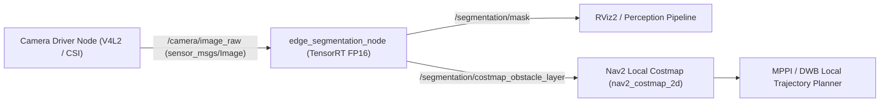

# ROS 2 Robotics Middleware Integration

This module bridges the real-time TensorRT semantic segmentation pipeline with the **ROS 2 (Robot Operating System 2)** robotics ecosystem, specifically targeting mobile ground robots (AGVs / AMRs) powered by NVIDIA Jetson Nano.

## Node Architecture: `edge_segmentation_node`



### Subscribed Topics
- `/camera/image_raw` (`sensor_msgs/msg/Image`): Live RGB camera stream at 30 FPS. Configured with `BEST_EFFORT` QoS to eliminate packet buffering latency.

### Published Topics
- `/segmentation/mask` (`sensor_msgs/msg/Image`): 2D semantic class segmentation mask for downstream perception tasks.
- `/segmentation/costmap_obstacle_layer` (`nav_msgs/msg/OccupancyGrid`): Real-time semantic obstacle grid fed directly into Nav2 costmap layers.

## Nav2 Costmap Semantic Layer Configuration

Add the semantic layer plugin to your `nav2_params.yaml`:

```yaml
local_costmap:
  local_costmap:
    ros__parameters:
      update_frequency: 30.0
      publish_frequency: 15.0
      plugins: ["voxel_layer", "semantic_obstacle_layer", "inflation_layer"]
      semantic_obstacle_layer:
        plugin: "nav2_costmap_2d::CostmapLayer"
        enabled: True
        topic: "/segmentation/costmap_obstacle_layer"
        observation_sources: semantic_scan
        track_unknown_space: false
```

## Running the ROS 2 Node on Jetson Nano

```bash
# Source ROS 2 Humble / Iron environment
source /opt/ros/humble/setup.bash

# Launch the segmentation node with compiled TensorRT engine
python3 deployment/ros2/segmentation_node.py --engine models/student.engine
```
