# System Architecture

This document provides a comprehensive technical overview of the **Resource-Aware Image Segmentation for Edge Robotics** system architecture. The architecture is engineered to balance high semantic segmentation accuracy with strict real-time latency (< 33.3 ms / > 30 FPS) and memory constraints (< 1 GB) on resource-constrained embedded platforms (NVIDIA Jetson Nano).

---

## 1. End-to-End System Architecture Diagram

```mermaid
flowchart TD
    %% Phase 1: Knowledge Distillation Training Pipeline
    subgraph Phase1["1. Offline Training & Knowledge Distillation Phase"]
        direction TB
        InputData["Input RGB Image (224x224x3) & GT Mask"]
        
        subgraph TeacherNet["Teacher Network (Frozen, ResNet-50 DeepLabV3)"]
            T_Backbone["ResNet-50 Backbone (Conv Stages 1-4)"]
            T_ASPP["Atrous Spatial Pyramid Pooling (ASPP)"]
            T_Logits["Teacher Logits Z_T (21 x 224 x 224)"]
            T_Backbone --> T_ASPP --> T_Logits
        end

        subgraph StudentNet["Student Network (Trainable, MobileNetV3-Small)"]
            S_Backbone["MobileNetV3-Small Backbone (Inverted Residuals)"]
            S_Head["Lightweight Conv Head (1x1 Conv + BN + ReLU)"]
            S_Logits["Student Logits Z_S (21 x 224 x 224)"]
            S_Backbone --> S_Head --> S_Logits
        end

        InputData --> T_Backbone
        InputData --> S_Backbone

        T_Logits --> Softmax_T["Temperature Softmax (tau = 4.0)"]
        S_Logits --> Softmax_S["Temperature Softmax (tau = 4.0)"]

        Softmax_T --> Loss_KD["KL-Divergence Distillation Loss (L_KD)"]
        Softmax_S --> Loss_KD

        S_Logits --> Loss_CE["Standard Task Loss (L_CE)"]
        InputData -.->|"Ground Truth Mask (y)"| Loss_CE

        Loss_KD --> TotalLoss["Total Loss: (1 - alpha)*L_CE + alpha*tau^2*L_KD"]
        Loss_CE --> TotalLoss
        TotalLoss -->|"Backpropagation"| S_Backbone
    end

    %% Phase 2: Edge Compilation & Optimization Pipeline
    subgraph Phase2["2. Edge Model Optimization & TensorRT Compilation"]
        direction TB
        PyTorchModel["Trained PyTorch Student Weights (.pth)"]
        ONNXExport["ONNX Exporter (Opset 14, Constant Folding, Static Shape)"]
        ONNXModel["Optimized ONNX Computational Graph (.onnx)"]
        
        subgraph TRTOptimizer["NVIDIA TensorRT 8.2 Engine Builder"]
            LayerFusion["Vertical & Horizontal Layer Fusion (Conv + BN + Act)"]
            PrecisionFP16["FP16 Half-Precision Kernel Selection"]
            KernelTuning["Kernel Auto-Tuning for Maxwell 128-Core GPU"]
            Workspace["Memory Workspace Pool Management"]
            LayerFusion --> PrecisionFP16 --> KernelTuning --> Workspace
        end

        TRTEngine["Serialized TensorRT Plan (.engine)"]

        TotalLoss -.->|"Save Student Checkpoint"| PyTorchModel
        PyTorchModel --> ONNXExport --> ONNXModel --> LayerFusion
        Workspace --> TRTEngine
    end

    %% Phase 3: Real-Time Edge Robotics Execution Pipeline
    subgraph Phase3["3. Real-Time Robotics Deployment (NVIDIA Jetson Nano)"]
        direction TB
        Camera["CSI-2 / USB Camera Stream (30 FPS)"]
        Preprocess["OpenCV Preprocessing (Resize 224x224, Norm, HWC->CHW) - 5.2 ms"]
        HostMem["Page-Locked Pinned Host Memory (PyCUDA Zero-Copy)"]
        
        subgraph EdgeGPU["Jetson Nano 128-Core Maxwell GPU (10W MAXN)"]
            H2D["Async Host-to-Device Transfer (CUDA Stream) - 0.8 ms"]
            TRTExec["TensorRT FP16 Kernel Execution - 24.1 ms"]
            D2H["Async Device-to-Host Transfer - 0.6 ms"]
            H2D --> TRTExec --> D2H
        end

        Postprocess["Channel-wise Argmax & Mask Generation - 2.3 ms"]
        
        subgraph RoboticsMiddleware["ROS 2 Robotics Ecosystem (Humble / Iron)"]
            ROSNode["edge_segmentation_node (Lifecycle Node)"]
            MaskTopic["/segmentation/mask (sensor_msgs/Image)"]
            CostmapTopic["/segmentation/costmap_obstacle_layer (nav_msgs/OccupancyGrid)"]
            Nav2Costmap["Nav2 Local Costmap (nav2_costmap_2d)"]
            Planner["MPPI / DWB Local Trajectory Planner"]
            ROSNode --> MaskTopic
            ROSNode --> CostmapTopic --> Nav2Costmap --> Planner
        end

        TRTEngine -.->|"Deserialize Engine"| TRTExec
        Camera --> Preprocess --> HostMem --> H2D
        D2H --> Postprocess --> ROSNode
    end

    style Phase1 fill:#f8f9fa,stroke:#495057,stroke-width:2px
    style Phase2 fill:#eef2ff,stroke:#4338ca,stroke-width:2px
    style Phase3 fill:#ecfdf5,stroke:#047857,stroke-width:2px
    style TotalLoss fill:#fef3c7,stroke:#d97706,stroke-width:2px
    style TRTEngine fill:#dbeafe,stroke:#1d4ed8,stroke-width:2px
    style RoboticsMiddleware fill:#f0fdf4,stroke:#16a34a,stroke-width:2px
```

---

## 2. Phase 1: Knowledge Distillation Formulation

To enable lightweight segmentation on embedded hardware without crippling accuracy, the system employs **Logits-Based Knowledge Distillation**:

### Mathematical Formulation
Given an input image $x$, let $z_T(x)$ and $z_S(x)$ denote the unnormalized output logits from the Teacher and Student networks respectively for class $c \in \{1, \dots, C\}$.

1. **Softened Probabilities**:
   $$\tilde{p}_T^{(c)} = \frac{\exp(z_T^{(c)} / \tau)}{\sum_{j=1}^C \exp(z_T^{(j)} / \tau)}, \quad \tilde{p}_S^{(c)} = \frac{\exp(z_S^{(c)} / \tau)}{\sum_{j=1}^C \exp(z_S^{(j)} / \tau)}$$
   where $\tau > 1$ is the temperature hyperparameter ($\tau = 4.0$). High temperature exposes the "dark knowledge" (inter-class similarity distributions learned by the teacher).

2. **Kullback-Leibler (KL) Divergence Distillation Loss**:
   $$L_{KD}(z_S, z_T) = \tau^2 \sum_{c=1}^C \tilde{p}_T^{(c)} \log \left(\frac{\tilde{p}_T^{(c)}}{\tilde{p}_S^{(c)}}\right)$$
   The $\tau^2$ scaling factor ensures gradient magnitudes remain consistent when varying temperature.

3. **Supervised Cross-Entropy Loss**:
   $$L_{CE}(y, z_S) = -\sum_{c=1}^C y_c \log \sigma(z_S^{(c)})$$
   where $y$ is the one-hot ground truth segmentation mask and $\sigma$ is the standard softmax ($\tau=1$).

4. **Multi-Objective Loss Function**:
   $$L_{total} = (1 - \alpha) L_{CE} + \alpha L_{KD}$$
   With $\alpha = 0.5$, balancing accurate ground-truth segmentation with rich soft guidance from the teacher.

---

## 3. Phase 2: Edge Compilation & TensorRT Graph Optimization

Edge deployment requires converting the trained dynamic PyTorch graph into a statically optimized TensorRT engine:

1. **ONNX Export**:
   - Frozen parameters and constant folding to eliminate redundant runtime calculations.
   - Fixed static input dimensions $(1 \times 3 \times 224 \times 224)$ avoiding dynamic shape allocation overhead.
   - Opset 14 ensures full support for modern pooling, interpolation, and depthwise convolution operators.

2. **TensorRT Layer & Tensor Fusion**:
   - **Vertical Fusion**: Fuses sequences of `Convolution + BatchNorm + HardSwish/ReLU` into single monolithic CUDA kernels, eliminating intermediate global memory round-trips.
   - **Horizontal Fusion**: Combines parallel 1x1 convolutions across feature channels into single execution blocks.

3. **FP16 Half-Precision Engine**:
   - Leverages native 16-bit floating-point execution on the Maxwell 128-core GPU architecture.
   - Halves memory bandwidth requirements from 4 bytes to 2 bytes per activation, critical for Jetson Nano's 25.6 GB/s memory bandwidth.

---

## 4. Phase 3: Real-Time Edge Robotics Execution Pipeline

The deployment pipeline is built for zero-copy, asynchronous execution on the Jetson Nano:

1. **Memory Management**:
   - Page-locked (pinned) host memory allocated via PyCUDA (`cuda.pagelocked_empty`), enabling direct memory access (DMA) transfers without CPU paging interrupts.

2. **Asynchronous CUDA Streams**:
   - Non-blocking execution via `context.execute_async_v2()` on a dedicated `cuda.Stream()`.
   - Host-to-Device transfer ($0.8\text{ ms}$), GPU kernel execution ($24.1\text{ ms}$), and Device-to-Host transfer ($0.6\text{ ms}$) operate asynchronously.

3. **ROS 2 Nav2 Costmap Integration**:
   - Semantic output is formatted into both a visualization mask (`sensor_msgs/msg/Image`) and an obstacle occupancy grid (`nav_msgs/msg/OccupancyGrid`).
   - Fed into `nav2_costmap_2d::CostmapLayer`, enabling autonomous mobile robots (AMRs) to classify traversable terrain versus hazardous dynamic obstacles in real time at **30.3 FPS**.
